[English](README.en.md) | **简体中文**

<picture>
  <source media="(max-width: 640px) and (prefers-color-scheme: dark)" srcset="assets/presentation/hero-mobile-dark.svg">
  <source media="(max-width: 640px)" srcset="assets/presentation/hero-mobile-light.svg">
  <source media="(prefers-color-scheme: dark)" srcset="assets/presentation/hero-dark.svg">
  
</picture>

**从已保存的 SSE 轨迹重组 tool-call 参数，按模型规则修复 JSON，并输出修复轨迹。**

`v0.3.0` · `Go 1.24+` · [MIT](LICENSE)

[Website](https://callpatch.lei6393.com) · [Demo record](docs/demo-results.json)

## 为什么使用

流式工具参数可能夹着围栏、sentinel，或缺失闭合字符。CallPatch 读取完整保存的 SSE，先按 tool-call 索引拼接，再运行有限的确定性修复。它让参数可以被检查，不代替调用者判断修复后的含义是否正确。

## 架构

<picture>
  <source media="(max-width: 640px) and (prefers-color-scheme: dark)" srcset="assets/presentation/architecture-mobile-dark.svg">
  <source media="(max-width: 640px)" srcset="assets/presentation/architecture-mobile-light.svg">
  <source media="(prefers-color-scheme: dark)" srcset="assets/presentation/architecture-dark.svg">
  
</picture>

internal/proxy/sse.go 重组 delta；internal/spec 根据模型选择 RepairSpec；internal/repair 处理围栏、引号、sentinel 与括号。`repair` 子命令把修复后的工具 envelope 写到 stdout，`serve` 子命令在本地反向代理的流内做同样修复。

规则注册表见 [internal/spec](internal/spec/)，修复管线见 [pipeline.go](internal/repair/pipeline.go)。已有合法 JSON 走原样返回路径。

## 安装

需要 Go 1.24+。示例用 go run 执行源码，首次构建可能下载依赖；修复本身只读取本地文件。

```bash
git clone https://github.com/SuperMarioYL/callpatch.git
cd callpatch
go build -o callpatch ./cmd/callpatch
```

## 快速开始

实际修复仓库自带的 Qwen3 与 DeepSeek SSE 示例。输出证明这两条输入经过修复后能生成参数 JSON，不证明截断前的原始语义被完整恢复，也没有运行实时代理。

```bash
go run ./cmd/callpatch repair --trace testdata/qwen3-broken.sse
go run ./cmd/callpatch repair --trace --model deepseek-v4 testdata/deepseek-broken.sse
```

输入在 [testdata](testdata/)，重放命令保存在 [examples/presentation_demo.sh](examples/presentation_demo.sh)。

## 使用

`repair [--trace] [--model NAME] FILE.sse` 是离线命令。--trace 为布尔开关，文件是位置参数；--model 覆盖流中的模型名。输出 function.arguments 仍是包含 JSON 的字符串，消费前需要再解析。修复后仍不是合法 JSON 的参数会以 `"_repaired": false` 输出、stderr 提示 `repair failed:` 并以非零码退出——不虚报修复结果。

`serve --upstream URL [--listen :8080] [--model NAME]` 是 v0.2 新增的实时代理命令：

```bash
llama-server -m Qwen3-... --port 8081
callpatch serve --upstream http://127.0.0.1:8081 --listen :8080
# Agent 的 OPENAI_BASE_URL 指向 http://127.0.0.1:8080
```

代理只在流式 `/v1/chat/completions` 响应上工作：整条 SSE 缓冲重组后跑同一套修复，需要修复时重新合成干净的 OpenAI chunk 流，无需修复时原样逐字节转发；`repaired: ...` 轨迹打到 stderr。非 chat 请求（如 `/v1/models`）原样转发。缓冲意味着首个字节会等到上游流结束——截断只有到流尾才可判定，这是修复语义决定的取舍。

## 实际 Demo

<picture>
  <source media="(max-width: 640px) and (prefers-color-scheme: dark)" srcset="assets/presentation/process-mobile-dark.svg">
  <source media="(max-width: 640px)" srcset="assets/presentation/process-mobile-light.svg">
  <source media="(prefers-color-scheme: dark)" srcset="assets/presentation/process-dark.svg">
  
</picture>

### Qwen3 围栏轨迹

从保存的 Qwen3 输入恢复可解析参数。

```text
$ go run ./cmd/callpatch repair --trace testdata/qwen3-broken.sse
{
  "_repaired": true,
  "function": {
    "arguments": "{\"city\":\"北京\",\"unit\":\"celsius\"}",
    "name": "get_weather"
  },
  "id": "call_01",
  "index": 0,
  "type": "function"
}
```

### DeepSeek sentinel

显式选择 DeepSeek 规则处理第二条输入。

```text
$ go run ./cmd/callpatch repair --trace --model deepseek-v4 testdata/deepseek-broken.sse
{
  "_repaired": true,
  "function": {
    "arguments": "{\"query\":\"vllm 工具调用\",\"top_k\":3}",
    "name": "search_web"
  },
  "id": "call_04",
  "index": 0,
  "type": "function"
}
```

## 能力与接入

<picture>
  <source media="(max-width: 640px) and (prefers-color-scheme: dark)" srcset="assets/presentation/integrations-mobile-dark.svg">
  <source media="(max-width: 640px)" srcset="assets/presentation/integrations-mobile-light.svg">
  <source media="(prefers-color-scheme: dark)" srcset="assets/presentation/integrations-dark.svg">
  
</picture>

CallPatch 的输入是已记录的失败轨迹，输出是待检查的参数 envelope。它与 Agent 或推理服务分工不同，不负责执行工具、补全任务或保证任意后端兼容。


## 配置

默认按流中模型选择规则；模型名先精确匹配、再做大小写不敏感的子串匹配（`deepseek-ai/DeepSeek-V4`、`Qwen/Qwen3-32B` 这类真实服务端 id 都能命中），空模型和未知模型会回退到 qwen3，未知模型还会在 stderr 提示。没有鉴权、TLS 或运行时配置文件。--trace 展示的是模型声明的策略列表及输入/输出字节数，不代表每个策略都实际改动了字节。

## 路线图与范围

已实现离线 repair、实时 serve 代理、Qwen3 与 DeepSeek 规则和示例。更多模型规则（GLM/Intern 等）仍是后续方向。

- 合成或补齐的参数需要人工或调用方校验，合法 JSON 不等于正确操作。
- serve 的修复路径在 httptest 集成测试下验证，尚未录制真实 llama.cpp 会话的端到端 demo；接入真实 Agent 前先用自己的轨迹验证。
- 未知模型会回退 Qwen3 规则，需留意 stderr。

[Terminal recording](assets/demo.gif) · [Recording script](docs/demo.tape)

## 许可证

[MIT](LICENSE)
